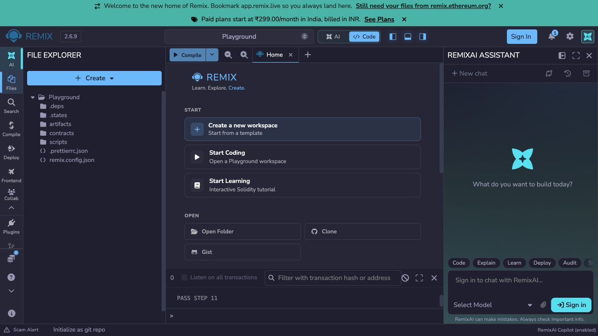
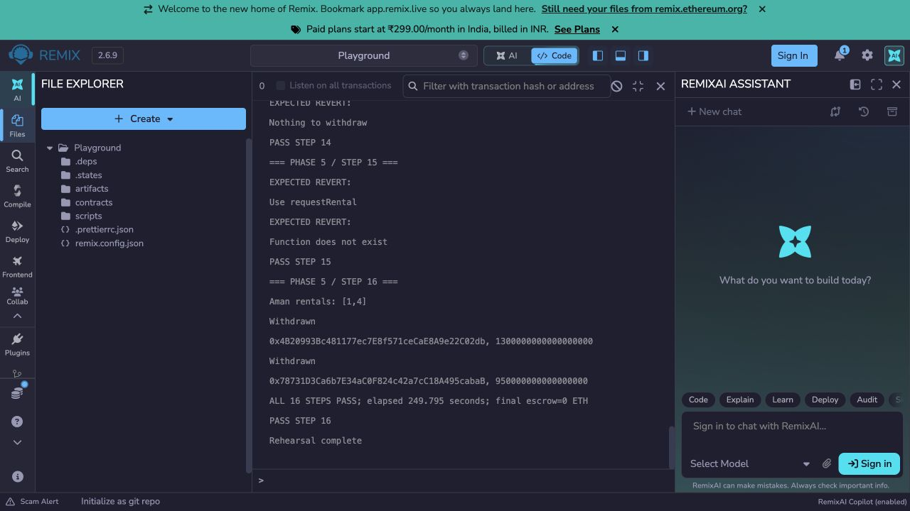

# LendLoop

Peer-to-peer campus item lending with smart-contract deposits.

## Current progress

Phases 1–5 are complete. The escrow supports listing, reputation-discounted rentals, full cancellation refunds, handover/return, late-fee settlement, timeouts, admin-resolved disputes, participant ratings, and withdrawals. Two scripted rehearsals in fresh Remix VMs verify the complete demo; screenshots and all 44 lab concept line references are included. Phase 6 is optional.

| File | Purpose |
|---|---|
| `contracts/Owned.sol` | Shared admin ownership, restricted ownership transfer, and abstract contract naming |
| `contracts/IReputation.sol` | Interface for completion records, ratings, and deposit discounts |
| `contracts/LateFee.sol` | Pure late-fee calculation with rounded-up time units and a deposit cap |
| `contracts/LendLoop.sol` | Complete rental escrow, refunds, timeouts, disputes, ratings, getters, and guarded pull-payment withdrawals |
| `contracts/Reputation.sol` | Completion records, one rating per rental/rater, average ratings, and reputation-based deposit discounts |

All files use `pragma solidity ^0.8.24`, require no external Solidity imports, and include `[LAB]` concept comments.

## Compile in Remix

1. Open [Remix IDE](https://remix.ethereum.org).
2. Upload the `contracts` folder.
3. Select Solidity compiler **0.8.24** and compile each file.

`Owned` is abstract and `IReputation` is an interface, so neither is deployed independently. `LateFee.calculate` is internal and needs no separate library deployment or linking.

For Phase 2, deploy `Reputation`, then call `setLendLoop` from the owner with a different Remix account's address. Switch to that account to record completions and ratings. Configuration is permanent for that instance. For the core rental demo, deploy a **fresh** `Reputation`, deploy `LendLoop` with its address, and call `setLendLoop` with the deployed `LendLoop` address.

## Verification

The Phase 1 helpers compiled without warnings or errors using Solidity 0.8.24. A temporary contract on a local test blockchain verified ownership behavior and nine late-fee scenarios. Results and manual reproduction instructions are in [Phase 1 verification](docs/phase-1-verification.md).

Phase 2 compiled with zero errors or warnings using Solidity 0.8.24. Automated local-chain checks passed for all discount tiers, late-return penalties, rating validation, duplicate prevention, events, and ownership restrictions. The core flow also passed in Remix VM. See [Phase 2 verification](docs/phase-2-verification.md) for results and a step-by-step Remix check.

Phase 3 compiled with zero errors or warnings using Solidity 0.8.24. Automated local-chain checks passed for full on-time and late rentals, real reputation discounts, exact payouts, fee caps, failed reputation updates, failed withdrawals, and reentrancy protection. See [Phase 3 verification](docs/phase-3-verification.md) for results and Remix reproduction steps.

Phase 4 compiled with zero errors or warnings using Solidity 0.8.24. All 21 planned test cases pass across the automated suites, including exact timeout boundaries, refunds, dispute splits, duplicate ratings, locked-item availability, rejected direct transfers, and a zero final escrow balance. See [Phase 4 verification](docs/phase-4-verification.md) for results and Remix reproduction steps.

Optional automated verification (Node.js required; Solidity files still need no external imports):

```sh
npm ci --prefix tests
npm test --prefix tests
```

See [the implementation plan](LendLoop_Implementation_Plan.md) for subsequent phases and the full design.

## Demo rehearsal

See [Phase 5 verification](docs/phase-5-verification.md) for two timed Remix VM rehearsals, all 32 step screenshots, transcripts, and repeatable demo commands. The rehearsals use real 60-second time units and end with zero escrow balance.





## Solidity lab concept map

Source line links match the Phase 5 rehearsal revision. Event consumption is demonstrated by the decoded transaction receipts in the Remix runner.

| # | Lab concept | Where | Line |
|---|---|---|---|
| 1 | Smart contract | `LendLoop`, `Reputation` | [LendLoop.sol:9](contracts/LendLoop.sol#L9), [Reputation.sol:8](contracts/Reputation.sol#L8) |
| 2 | Abstract contract | `Owned` | [Owned.sol:5](contracts/Owned.sol#L5) |
| 3 | Constructor (no params) | `Owned` | [Owned.sol:11](contracts/Owned.sol#L11) |
| 4 | Constructor (with params) | `LendLoop(address, uint256)` | [LendLoop.sol:102](contracts/LendLoop.sol#L102) |
| 5 | State variables | `itemCount`, `rentalCount`, `owner` | [LendLoop.sol:41](contracts/LendLoop.sol#L41), [Owned.sol:6](contracts/Owned.sol#L6) |
| 6 | `constant` | `CONFIRM_WINDOW_UNITS`, `DEFAULT_AFTER_UNITS` | [LendLoop.sol:37](contracts/LendLoop.sol#L37) |
| 7 | `immutable` | `reputation`, `timeUnit` | [LendLoop.sol:39](contracts/LendLoop.sol#L39) |
| 8 | **public** function | `listItem` (5-arg), `requiredPayment`, `transferOwnership` | [LendLoop.sol:120](contracts/LendLoop.sol#L120), [Owned.sol:22](contracts/Owned.sol#L22) |
| 9 | **external** function | `requestRental`, `withdraw`, `approveRental`, … | [LendLoop.sol:190](contracts/LendLoop.sol#L190) |
| 10 | **internal** function | `_settle`, `_transferOwnership` | [LendLoop.sol:285](contracts/LendLoop.sol#L285), [Owned.sol:27](contracts/Owned.sol#L27) |
| 11 | **private** function | `_discountedDeposit`, `_credit` | [LendLoop.sol:168](contracts/LendLoop.sol#L168), [LendLoop.sol:306](contracts/LendLoop.sol#L306) |
| 12 | public state variable (auto getter) | `owner`, `items`, `rentals`, `isStudent` | [Owned.sol:6](contracts/Owned.sol#L6), [LendLoop.sol:43](contracts/LendLoop.sol#L43) |
| 13 | private state variable | `pendingWithdrawals`, `locked`, `profiles` | [LendLoop.sol:47](contracts/LendLoop.sol#L47), [Reputation.sol:18](contracts/Reputation.sol#L18) |
| 14 | `view` function | `pendingBalance`, `getItem`, `discountPercent` | [LendLoop.sol:319](contracts/LendLoop.sol#L319), [Reputation.sol:60](contracts/Reputation.sol#L60) |
| 15 | `pure` function | `LateFee.calculate`, `contractName` | [LateFee.sol:15](contracts/LateFee.sol#L15), [LendLoop.sol:335](contracts/LendLoop.sol#L335) |
| 16 | `payable` function | `requestRental` | [LendLoop.sol:174](contracts/LendLoop.sol#L174) |
| 17 | `receive()` | `LendLoop` | [LendLoop.sol:327](contracts/LendLoop.sol#L327) |
| 18 | `fallback()` | `LendLoop` | [LendLoop.sol:331](contracts/LendLoop.sol#L331) |
| 19 | Modifier | `onlyOwner`, `onlyStudent`, `nonReentrant` | [Owned.sol:16](contracts/Owned.sol#L16), [LendLoop.sol:95](contracts/LendLoop.sol#L95) |
| 20 | Modifier with parameters | `inStatus(id, status)`, `onlyLender(id)` | [LendLoop.sol:89](contracts/LendLoop.sol#L89), [LendLoop.sol:79](contracts/LendLoop.sol#L79) |
| 21 | Event declaration | all events in `LendLoop` | [LendLoop.sol:57](contracts/LendLoop.sol#L57) |
| 22 | `indexed` event params | `RentalRequested` | [LendLoop.sol:60](contracts/LendLoop.sol#L60) |
| 23 | Emitting events | every state-changing function | [LendLoop.sol:112](contracts/LendLoop.sol#L112) |
| 24 | Listening to events | Remix logs / `contract.on(...)` in index.html | [Decoded Remix receipt logs](scripts/demo-runner.js#L12); [screenshots](docs/phase-5-verification.md) |
| 25 | `struct` | `Item`, `Rental`, `Profile` | [LendLoop.sol:13](contracts/LendLoop.sol#L13), [Reputation.sol:9](contracts/Reputation.sol#L9) |
| 26 | `enum` | `Status` | [LendLoop.sol:11](contracts/LendLoop.sol#L11) |
| 27 | `mapping` | `items`, `rentals`, `isStudent` | [LendLoop.sol:43](contracts/LendLoop.sol#L43) |
| 28 | Nested mapping | `hasRated[rentalId][addr]` | [Reputation.sol:19](contracts/Reputation.sol#L19) |
| 29 | Arrays | `userRentals` → `uint256[]` | [LendLoop.sol:46](contracts/LendLoop.sol#L46), [LendLoop.sol:145](contracts/LendLoop.sol#L145) |
| 30 | `require` | input checks everywhere | [LendLoop.sol:123](contracts/LendLoop.sol#L123) |
| 31 | Custom error + `revert` | `NotAStudent`, `InvalidStatus`, `TooEarly` | [LendLoop.sol:52](contracts/LendLoop.sol#L52), [LendLoop.sol:75](contracts/LendLoop.sol#L75) |
| 32 | `assert` | `_settle` | [LendLoop.sol:247](contracts/LendLoop.sol#L247) |
| 33 | Inheritance | `LendLoop is Owned` | [LendLoop.sol:9](contracts/LendLoop.sol#L9) |
| 34 | Multiple inheritance | `Reputation is Owned, IReputation` | [Reputation.sol:8](contracts/Reputation.sol#L8) |
| 35 | `virtual` / `override` | `contractName()`, `transferOwnership` | [Owned.sol:33](contracts/Owned.sol#L33), [LendLoop.sol:335](contracts/LendLoop.sol#L335) |
| 36 | Interface | `IReputation` | [IReputation.sol:5](contracts/IReputation.sol#L5) |
| 37 | Library | `LateFee` | [LateFee.sol:6](contracts/LateFee.sol#L6) |
| 38 | Contract-to-contract call | `LendLoop` → `Reputation` | [LendLoop.sol:281](contracts/LendLoop.sol#L281) |
| 39 | `try` / `catch` | `_settle` | [LendLoop.sol:299](contracts/LendLoop.sol#L299) |
| 40 | Function overloading | two `listItem` versions | [LendLoop.sol:120](contracts/LendLoop.sol#L120), [LendLoop.sol:131](contracts/LendLoop.sol#L131) |
| 41 | Data locations | `storage` in `_settle`, `memory` returns, `calldata` reason | [LendLoop.sol:206](contracts/LendLoop.sol#L206), [LendLoop.sol:135](contracts/LendLoop.sol#L135), [LendLoop.sol:231](contracts/LendLoop.sol#L231) |
| 42 | Global variables | `msg.sender`, `msg.value`, `block.timestamp`, `address(this).balance` | [LendLoop.sol:180](contracts/LendLoop.sol#L180), [LendLoop.sol:217](contracts/LendLoop.sol#L217), [LendLoop.sol:324](contracts/LendLoop.sol#L324) |
| 43 | Sending ETH | `call{value: ...}` in `withdraw` | [LendLoop.sol:314](contracts/LendLoop.sol#L314) |
| 44 | Reentrancy protection | `nonReentrant` + checks-effects-interactions | [LendLoop.sol:95](contracts/LendLoop.sol#L95), [LendLoop.sol:310](contracts/LendLoop.sol#L310) |
