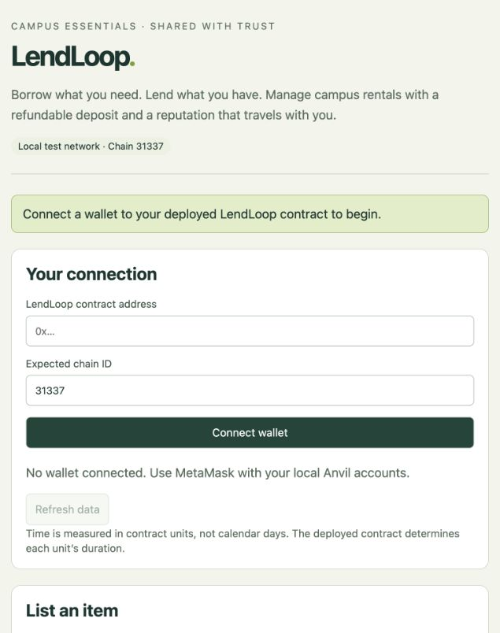

# LendLoop
## Peer-to-peer campus lending with smart-contract deposits

Project report | 31 October 2026

Academic details: team names, roll numbers, institution, department, course and guide were not supplied. Add these before academic submission.

### Abstract
Campus lending of calculators, drafters and other equipment depends on trust between students. LendLoop implements an Ethereum-compatible escrow that locks rent and a reputation-adjusted deposit, records a rental lifecycle, and credits deterministic payouts after return. A separate reputation contract records on-time and late completions and participant ratings. The implementation includes cancellation refunds, capped late fees, timeouts for silent participants, admin-resolved disputes and guarded withdrawals. Five Solidity files require no third-party Solidity imports; a single HTML page provides an optional wallet interface. Local automated tests cover all 21 planned cases, and two scripted Remix VM rehearsals completed all 16 demo steps with zero remaining escrow. Public Sepolia deployment remains pending funding. The system demonstrates transparent financial rules while retaining explicit trust in physical confirmations, student registration and dispute decisions.

### Submission scope
This report describes the repository implementation and recorded local verification. It does not claim a security audit, a public deployment, or personal practice by every team member. All ETH amounts shown in the demo are local test ETH.

### Reading guide
| Page | Content |
|---|---|
| 2 | Problem, blockchain rationale and roles |
| 3 | Rental states and money flow |
| 4 | Contract architecture and key functions |
| 5-6 | All 44 Solidity lab concepts |
| 7-8 | Implementation, screenshots and demo results |
| 9 | Planned test cases and results |
| 10 | Security controls and trust boundaries |
| 11 | Limitations, future scope and conclusion |
| 12 | Reproduction, evidence and handoff |

<!-- pagebreak -->

## 1. Problem statement and rationale

A borrower risks losing a deposit if a lender refuses to refund it. A lender risks damage, late return or non-return. Informal messages provide weak accounting, and an ordinary payment alone does not enforce the rental agreement. The project aims to make deposits, deadlines and settlement rules inspectable, with a repeatable classroom demonstration.

### Why blockchain fits this prototype
Escrow lives at the contract address. The deployed contracts expose their rules and emit events for important transitions. Neither participant can simply edit stored rental terms, and the implementation exposes no general admin withdrawal of user funds. Users independently withdraw the balances credited to them. The contracts have no upgrade mechanism; a changed implementation requires a new deployment.

These properties do not eliminate trust. The admin can decide how a disputed deposit is divided, and the chain cannot inspect a physical item. An ordinary database and payment service could be operationally simpler; this project specifically explores programmable escrow and public transaction evidence. Reputation is a history tied to an address, not proof of a person's identity or honesty.

### Roles and permissions
| Role | Permitted actions | Trust or restriction |
|---|---|---|
| Admin / owner | Register/remove students; resolve disputes; transfer ownership | Trusted for membership and deposit division |
| Registered lender | List/pause free items; approve/reject; confirm return; raise dispute | Only lender of that rental can act |
| Registered borrower | Request with exact payment; cancel before handover; confirm handover; mark return | Cannot rent own listing |
| Rental participant | Rate a Completed or Resolved rental; withdraw own credit | One rating per participant per rental |
| Any account | Read public data; claim an eligible timeout | Contract deadlines and states still apply |

Registration gates new listings and requests. Removing a student does not strand existing rentals: participant actions, ratings and withdrawals remain possible. The admin need not also be a registered student. Demo account names are illustrative roles, not submitted team identities.

<!-- pagebreak -->

## 2. System design: lifecycle and accounting

| Current state | Action and actor | Next state |
|---|---|---|
| Requested (0) | Lender approves | Approved (1) |
| Requested (0) | Lender rejects / borrower cancels | Cancelled (7) |
| Approved (1) | Borrower cancels | Cancelled (7) |
| Approved (1) | Borrower confirms handover | Active (2) |
| Active (2) | Borrower marks return | ReturnClaimed (3) |
| Active (2) | Anyone claims at dueAt + 3 time units | Defaulted (8) |
| ReturnClaimed (3) | Lender confirms / anyone claims after 2 units | Completed (4) |
| ReturnClaimed (3) | Lender disputes before 2 units expire | Disputed (5) |
| Disputed (5) | Admin chooses deposit split | Resolved (6) |

The diagram below summarizes the same transitions; arrows follow the permissions and deadlines in the table. Terminal states cannot be settled a second time. A separate occupancy mapping prevents a lender from reopening an item while any rental is ongoing. Default clears occupancy but keeps the missing item unavailable until the lender explicitly relists it.

<!-- rental-diagram -->

### Money flow (all calculations use integer wei)
Let R = rentPerUnit x units; D = baseDeposit - floor(baseDeposit x discount / 100). The borrower pays exactly R + D. Let F = min(ceil(max(0, returnedAt - dueAt) / timeUnit) x lateFeePerUnit, D).

| Outcome | Lender credit | Borrower credit |
|---|---|---|
| Cancelled or rejected before handover | 0 | R + D |
| Completed (including return timeout) | R + F | D - F |
| Defaulted (no recorded return) | R + D | 0 |
| Dispute resolved with lender share p | R + floor(D x p / 100) | D - floor(D x p / 100) |

The split uses the deposit actually paid after discount. Disputes add no separate automatic late fee. Settlement credits balances; ETH leaves only through withdraw(). The normal and dispute paths assert that lender plus borrower credits equal R + D. Pending credits from several rentals accumulate.

The demo unit is 60 seconds; a deployment can choose another positive duration. dueAt starts at handover, not request. Late fees use the stored return timestamp, so delayed confirmation does not increase the fee. At exactly returnedAt + 2 units the dispute window is closed and timeout settlement is open.

<!-- pagebreak -->

## 3. Smart contract architecture

| Component | Relationship and responsibility |
|---|---|
| Owned | Abstract base for LendLoop and Reputation; owner, modifier, ownership transfer, virtual name |
| IReputation | Interface implemented by Reputation; typed calls from LendLoop |
| LateFee | Internal pure library function compiled into LendLoop; no separate deployment |
| Reputation | Inherits Owned and IReputation; profiles, discounts and duplicate-rating prevention |
| LendLoop | Inherits Owned; item registry, rental state machine, escrow and withdrawal accounting |

Architecture: Owned -> LendLoop; Owned + IReputation -> Reputation. LendLoop calls Reputation through IReputation and calculates fees through LateFee. The HTML client reads and transacts with LendLoop and reads linked reputation data.

### Deployment and configuration
Deploy a fresh Reputation, deploy LendLoop(reputationAddress, 60), then call Reputation.setLendLoop(lendLoopAddress) as its owner. Register the lender and borrowers. The writer can be set only once and cannot be zero. LendLoop's reputation reference and timeUnit are immutable. Owned and IReputation are not deployed independently.

### Main functions and storage
Item stores lender, name, rent, base deposit, late fee, maximum units and availability. Rental snapshots the parties, rent, actual deposit, units, timestamps and status. Public mappings expose records; getItem/getRental validate IDs and return structs. Private mappings track occupancy, pending withdrawals and per-user rental arrays.

listItem has five- and three-argument overloads. The shorter form uses deposit / 10 as late fee and seven maximum units. requiredPayment returns rent, discounted deposit and total; requestRental checks exact msg.value and locks the item. approveRental, confirmHandover, markReturned and confirmReturn implement the normal path. Cancellation, dispute and timeout functions implement the exceptional paths. withdraw sends only the caller's credited balance.

### Reputation rules
| Borrower history | Deposit discount |
|---|---|
| lateReturns > onTimeReturns | 0%, overriding other tiers |
| At least 5 on-time returns | 50% |
| At least 3 on-time returns | 25% |
| At least 1 on-time return | 10% |
| Otherwise | 0% |

Ratings are 1-5 stars; averageRating returns the average scaled by 100. Ratings do not determine deposit discounts. Normal settlements record completion; resolved disputes allow ratings without adding a normal completion. Cancellations and defaults add neither ratings nor completion records.

<!-- pagebreak -->

## 4. Solidity concepts used (1-22)

The following map is derived from the current source links in README.md. Line references identify the implementation, not a separate sample contract.

| # | Concept | Implementation | Reference |
|---|---|---|---|
| 1 | Smart contract | LendLoop, Reputation | LendLoop.sol:9; Reputation.sol:8 |
| 2 | Abstract contract | Owned | Owned.sol:5 |
| 3 | Constructor (no params) | Owned | Owned.sol:11 |
| 4 | Constructor (with params) | LendLoop(address, uint256) | LendLoop.sol:102 |
| 5 | State variables | itemCount, rentalCount, owner | LendLoop.sol:41; Owned.sol:6 |
| 6 | `constant` | CONFIRM_WINDOW_UNITS, DEFAULT_AFTER_UNITS | LendLoop.sol:37 |
| 7 | `immutable` | reputation, timeUnit | LendLoop.sol:39 |
| 8 | public function | listItem (5-arg), requiredPayment, transferOwnership | LendLoop.sol:120; Owned.sol:22 |
| 9 | external function | requestRental, withdraw, approveRental, … | LendLoop.sol:190 |
| 10 | internal function | _settle, _transferOwnership | LendLoop.sol:285; Owned.sol:27 |
| 11 | private function | _discountedDeposit, _credit | LendLoop.sol:168; LendLoop.sol:306 |
| 12 | public state variable (auto getter) | owner, items, rentals, isStudent | Owned.sol:6; LendLoop.sol:43 |
| 13 | private state variable | pendingWithdrawals, locked, profiles | LendLoop.sol:47; Reputation.sol:18 |
| 14 | `view` function | pendingBalance, getItem, discountPercent | LendLoop.sol:319; Reputation.sol:60 |
| 15 | `pure` function | LateFee.calculate, contractName | LateFee.sol:15; LendLoop.sol:335 |
| 16 | `payable` function | requestRental | LendLoop.sol:174 |
| 17 | `receive()` | LendLoop | LendLoop.sol:327 |
| 18 | `fallback()` | LendLoop | LendLoop.sol:331 |
| 19 | Modifier | onlyOwner, onlyStudent, nonReentrant | Owned.sol:16; LendLoop.sol:95 |
| 20 | Modifier with parameters | inStatus(id, status), onlyLender(id) | LendLoop.sol:89; LendLoop.sol:79 |
| 21 | Event declaration | all events in LendLoop | LendLoop.sol:57 |
| 22 | `indexed` event params | RentalRequested | LendLoop.sol:60 |

<!-- pagebreak -->

## 4. Solidity concepts used (23-44)

| # | Concept | Implementation | Reference |
|---|---|---|---|
| 23 | Emitting events | every state-changing function | LendLoop.sol:112 |
| 24 | Listening to events | Remix logs / contract.on(...) in index.html | Decoded Remix receipt logs; screenshots |
| 25 | `struct` | Item, Rental, Profile | LendLoop.sol:13; Reputation.sol:9 |
| 26 | `enum` | Status | LendLoop.sol:11 |
| 27 | `mapping` | items, rentals, isStudent | LendLoop.sol:43 |
| 28 | Nested mapping | hasRated[rentalId][addr] | Reputation.sol:19 |
| 29 | Arrays | userRentals → uint256[] | LendLoop.sol:46; LendLoop.sol:145 |
| 30 | `require` | input checks everywhere | LendLoop.sol:123 |
| 31 | Custom error + `revert` | NotAStudent, InvalidStatus, TooEarly | LendLoop.sol:52; LendLoop.sol:75 |
| 32 | `assert` | _settle | LendLoop.sol:247 |
| 33 | Inheritance | LendLoop is Owned | LendLoop.sol:9 |
| 34 | Multiple inheritance | Reputation is Owned, IReputation | Reputation.sol:8 |
| 35 | `virtual` / `override` | contractName(), transferOwnership | Owned.sol:33; LendLoop.sol:335 |
| 36 | Interface | IReputation | IReputation.sol:5 |
| 37 | Library | LateFee | LateFee.sol:6 |
| 38 | Contract-to-contract call | LendLoop → Reputation | LendLoop.sol:281 |
| 39 | `try` / `catch` | _settle | LendLoop.sol:299 |
| 40 | Function overloading | two listItem versions | LendLoop.sol:120; LendLoop.sol:131 |
| 41 | Data locations | storage in _settle, memory returns, calldata reason | LendLoop.sol:206; LendLoop.sol:135; LendLoop.sol:231 |
| 42 | Global variables | msg.sender, msg.value, block.timestamp, address(this).balance | LendLoop.sol:180; LendLoop.sol:217; LendLoop.sol:324 |
| 43 | Sending ETH | call{value: ...} in withdraw | LendLoop.sol:314 |
| 44 | Reentrancy protection | nonReentrant + checks-effects-interactions | LendLoop.sol:95; LendLoop.sol:310 |

Event consumption is demonstrated by decoded Remix receipts and by contract.on subscriptions in the optional wallet page. A declaration alone is not evidence of listening. The full README map retains clickable source links for all 44 concepts.

<!-- pagebreak -->

## 5. Implementation and demonstration

The five contracts use Solidity ^0.8.24. Verification pins compiler 0.8.24 with optimizer disabled and Shanghai EVM for the deployment build. LendLoop's unoptimized runtime is 22,819 bytes, below the 24,576-byte runtime limit. There are no third-party Solidity imports. The optional frontend uses pinned ethers 6.13.4 from a CDN and an injected wallet; it needs no frontend build.

The page provides role-aware listings, exact quotes, rental actions, dispute controls, ratings, withdrawals and live events. It invalidates account/network state on wallet changes and renders untrusted item names as text. A local helper starts chain 31337, deploys/configures both contracts and seeds registered test accounts and a calculator listing.

Figure 1. Recorded Phase 6 wallet-page preview. Interface automation uses a local wallet adapter; manual MetaMask popup signing is not claimed.

### Rehearsal method
The Section 7 demo was executed twice in separate fresh Remix VMs. The scripted runner used actual 60-second units and real waits for the late return and silent-lender timeout. Expected failures were checked through call simulation; Phase 4 separately checked mined rejection of direct transfers. These are automated rehearsals, not measured human presentation times.

<!-- pagebreak -->

## 5. Demo outcomes and screenshot evidence

| Measure | Run 1 | Run 2 |
|---|---|---|
| All scripted steps | 16 passed | 16 passed |
| Elapsed time, excluding setup | 248.864 s | 249.795 s |
| Late fee charged to Aman | 0.20 ETH | 0.20 ETH |
| Neha's discounted next quote | 0.91 ETH | 0.91 ETH |
| Disputed 0.90 ETH deposit | 0.45 / 0.45 ETH | 0.45 / 0.45 ETH |
| Final escrow balance | 0 ETH | 0 ETH |

Figure 2. Recorded Remix late-return settlement with decoded events.

Figure 3. Recorded completion and final withdrawals. Across four rentals, 2.94 ETH was escrowed and fully credited: Riya 0.69, Aman 1.30 and Neha 0.95 ETH. These values exclude wallet gas costs.

All 32 per-step screenshots, both complete transcripts and a source-hash manifest are linked in docs/phase-5-verification.md. The report selects three readable images; the full gallery supplies evidence for each of the 16 steps in both runs.

<!-- pagebreak -->

## 6. Testing and results

Tests compile the repository sources and transact on disposable Ganache chains with ethers. Timeout checks advance local time deterministically. The Phase 6 suite drives page forms against a real local contract through an injected adapter. Phase 7 verifies preparation and a small-value flow locally, without claiming Sepolia success.

| Test and requirement | Result |
|---|---|
| T1 - Owner-only registration | Pass |
| T2 - Students-only listing/request | Pass |
| T3 - Exact payment | Pass |
| T4 - No self-rental | Pass |
| T5 - No concurrent rental | Pass |
| T6 - Rental units | Pass |
| T7 - Only lender approves | Pass |
| T8 - Return confirmation state | Pass |
| T9 - On-time return | Pass |
| T10 - Late fee/cap | Pass |
| T11 - Reject/cancel refunds | Pass |
| T12 - Early timeout | Pass |
| T13 - Silent lender | Pass |
| T14 - Never returned | Pass |
| T15 - Dispute share bounds | Pass |
| T16 - Duplicate rating | Pass |
| T17 - Premature rating | Pass |
| T18 - Empty withdrawal | Pass |
| T19 - Direct ETH | Pass |
| T20 - Reputation write restriction | Pass |
| T21 - No stuck rental funds | Pass |

Additional checks exercise failed reputation calls, failed recipient transfers, withdrawal reentrancy, exact timeout/dispute boundaries, removed-student continuation, ABI parity, hostile listing text, wallet invalidation and funding/network guards. The 21 rows summarize planned requirements rather than the count of individual assertions.

The full Phase 2, 3, 4, 6 and 7 suites were rerun for this handoff on 31 October 2026; the Phase 8 verification record stores the outcome. Local tests and historic Remix screenshots do not constitute a production audit.

<!-- pagebreak -->

## 7. Security considerations

| Control | Implementation and practical effect |
|---|---|
| Pull payments | Finalization only credits balances; a receiver cannot block another party's settlement |
| Checks-effects-interactions | withdraw reads credit, checks it, clears it, then calls the receiver |
| Reentrancy guard | locked modifier rejects nested withdrawals; failed sends revert and restore credit |
| Role and state checks | onlyOwner, onlyStudent, rental-party modifiers and inStatus restrict transitions |
| Exact payment | msg.value must equal quoted rent plus actual deposit; no accidental overpayment credit |
| Item occupancy | An active-rental mapping prevents availability edits bypassing a rental lock |
| Conserved settlement | assert checks both normal and dispute splits sum to rent plus deposit |
| Capped late fee | Fee cannot exceed the actual paid deposit |
| Restricted reputation writes | Only the configured LendLoop writer can record completion or ratings |
| Best-effort completion record | try/catch preserves monetary settlement if recordCompletion fails |
| Direct-transfer rejection | receive and fallback reject ordinary unsolicited ETH and unknown calls |

Authorization uses msg.sender. The implementation does not use tx.origin for authorization or provide a selfdestruct function. Solidity 0.8 checked arithmetic reverts on overflow; it does not make inputs or economics automatically safe.

### Boundaries the controls do not solve
The constructor checks a nonzero reputation address but does not prove its code or interface. Deployment must use the intended Reputation and verify its writer. Completion recording has a catch path; requiredPayment's reputation lookup and rating calls can still fail and are not protected by that catch.

The admin can allocate 0-100% of a disputed deposit to the lender; it cannot redirect that split to an arbitrary account through resolveDispute. Ownership transfer changes this trusted role. There is no deadline forcing an admin to resolve Disputed rentals. The system cannot independently verify handover, return, damage, or the truth of a dispute reason.

Ordinary ETH transfers are rejected, but externally forced ETH can still affect address(this).balance. Zero escrow is verified for the controlled demo's funded rentals; it is not a universal guarantee that unsolicited ETH is recoverable. Events, names and dispute reasons are public: do not put private student details into them.

<!-- pagebreak -->

## 8. Limitations and future scope

### Limitations of the current prototype
Physical confirmation remains an oracle problem. A dishonest return claim or dispute cannot be adjudicated by contract code alone. Timeouts provide an exit when an eligible transaction is submitted; contracts do not wake themselves up. Public-chain timestamps and transaction inclusion can affect when an action becomes executable.

Student registration is centralized and does not prove identity. The address-based reputation history can be abandoned by changing accounts or manipulated through collusive rentals; it is not unforgeable real-world reputation. The one-time writer configuration makes deployment mistakes costly. There is no upgrade, emergency pause, generalized recovery, or migration mechanism.

Deposits can be economically inadequate relative to item value. Discounts reduce collateral; defaults and disputes currently do not add a late-return completion penalty. A default keeps the listing unavailable but cannot physically recover the item. The policy is a classroom choice, not a complete risk model.

The frontend depends on an external CDN and wallet, reads records sequentially, and lacks an indexer for large datasets. Wallet signing was simulated in automated tests; a manual MetaMask popup rehearsal is still pending. The optional public Sepolia deployment has no successful receipt evidence because funded accounts are unavailable. The current work demonstrates test-ETH accounting, not real-money readiness.

### Future scope
| Improvement | Expected benefit and prerequisite |
|---|---|
| Multisignature or jury dispute resolution | Reduce single-admin discretion; define escalation and deadlines |
| Stronger campus identity integration | Reduce address switching and duplicate accounts; protect personal data |
| More explicit default/reputation policy | Align collateral discounts with actual repayment and return risk |
| Mobile interface and event indexer | Improve usability and scale reads beyond a classroom dataset |
| Stable-value payment exploration | Reduce ETH price exposure; first examine token behavior, access and applicable requirements |
| Independent review and operational testing | Assess failure modes before any use beyond a controlled prototype |

### Conclusion
LendLoop implements the planned lending lifecycle with deterministic deposit accounting, observable transactions, reputation discounts and exceptional exits. Local suites cover all 21 planned cases; two complete Remix VM runs finish with zero escrow. The project demonstrates the value of programmable escrow and the limits of applying it to physical goods. Public deployment and human rehearsal are separate outstanding activities, with no unsupported claim that either has occurred.

<!-- pagebreak -->

## 9. Reproduction and evidence index

### Run the checks and local interface
From the project root, install pinned tools with npm ci --prefix tests and run npm test --prefix tests. For the wallet demo, run npm run demo --prefix tests and keep it running. In another terminal run python3 -m http.server 8000 --directory frontend, then open http://localhost:8000 in a browser with MetaMask. Use the printed local test accounts, RPC http://127.0.0.1:8545, chain 31337 and deployed address. Reconnect after account changes. Restarting the demo resets its chain.

### Remix path
Upload contracts to Remix, compile with 0.8.24, and use a fresh Remix VM. Deploy Reputation then LendLoop(reputationAddress, 60), set the writer and register students. Follow the exact account switches and wei inputs in Section 7 of the implementation plan. For scripted reproduction, run scripts/phase-5-auto.txt in a fresh Remix terminal; allow about five minutes for real waits. Always quote requiredPayment before a request and reset Remix Value to zero afterward.

### Primary project references
| Reference | What it establishes |
|---|---|
| contracts/*.sol | Actual contract behavior and [LAB] concept annotations |
| LendLoop_Implementation_Plan.md, Sections 7-10 | Demo sequence, planned tests, report and viva requirements |
| README.md | Setup, complete clickable concept map and phase status |
| docs/phase-1-verification.md through phase-4-verification.md | Helper, reputation, escrow and exceptional-path verification |
| docs/phase-5-verification.md | Two 16-step rehearsals and all 32 screenshot links |
| docs/phase-5-run-1.txt / phase-5-run-2.txt | Complete recorded Remix transcripts |
| docs/phase-5-source-manifest.json | Source and runner hashes for recorded rehearsals |
| docs/phase-6-verification.md | Interface coverage and manual-signing limitations |
| docs/phase-7-verification.md | Sepolia preparation and pending public receipts |
| docs/phase-8-verification.md | This handoff's validation and remaining human actions |
| docs/viva-preparation.md | Short answers, demo recovery and personal practice sheet |

### Submission handoff
The report is supplied as editable Markdown and a 12-page PDF. Add the missing academic identity details, have every member independently practise the manual demo and viva, and record actual practice dates in the guide. Use local Remix evidence for assessment unless and until public receipts exist. Phase 8's authored deliverables are ready; personal rehearsal cannot be inferred from scripted runs.
